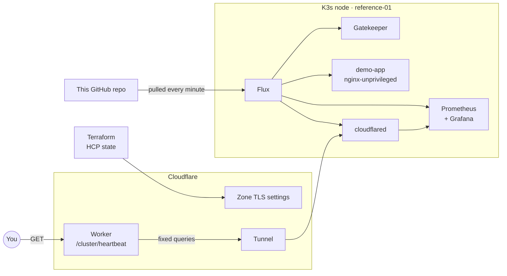

# Kubernetes platform reference

I built and run this Kubernetes cluster in public as a work sample for platform and security engineering roles. Flux deploys everything in it from this repo. OPA Gatekeeper rejects unsafe workloads at admission. A Cloudflare Worker publishes a health summary, the heartbeat, that you can query now:

```console
$ curl -s https://api.s34nj0hn.dev/cluster/heartbeat
{"status":"online","node_count":1,"running_pods":19,"total_pods":19,"succeeded_pods":0,
 "cluster_uptime_seconds":12092489,"cpu_usage_pct":19.5,"memory_usage_pct":64.8,"pvc_bound":0,
 "flux_ready":true,"gatekeeper_constraints":2,"gatekeeper_violations":0,"last_reconcile_age_seconds":54}
```

I captured that response on 2026-10-13, 140 days into the cluster's current uptime.

My homelab runs my own services and carries old migrations and storage decisions, which makes it a poor thing to hand a reviewer. This cluster is a separate build of the same practices, on one K3s node in a VM on hardware I own. It runs one nginx app so that a reviewer can read the whole platform in an afternoon. You can check each claim below against the code, the docs, or the heartbeat.

## What the platform runs

| Area | Tools | What this repo does with them |
| --- | --- | --- |
| GitOps | Flux 2.9, Kustomize, Helm | Five Kustomizations with dependency ordering. Changes reach the cluster only through a commit to `main`. |
| Policy as code | OPA Gatekeeper 3.23 | Two constraints in deny mode, and a test fixture the admission webhook must reject |
| Network security | Kubernetes NetworkPolicy | The demo namespace starts at default deny and opens DNS egress and one serving port |
| Workload hardening | Pod security context | Non-root nginx, seccomp `RuntimeDefault`, no privilege escalation, and every Linux capability dropped |
| Observability | kube-prometheus-stack, Grafana | Prometheus fits a 3.9Gi node after I cut its active series by 28% |
| Infrastructure as code | Terraform, HCP Terraform | Cloudflare zone TLS settings in remote state, with a written ownership boundary against Flux and Wrangler |
| Public API | Cloudflare Workers, TypeScript, Vitest | The heartbeat, with fixed server-side queries, a 30 second cache, and unit tests |
| Tunnel | Cloudflare Tunnel | Grafana has no ingress. `cloudflared` connects out to Cloudflare, and the Worker reaches Grafana through that tunnel. |
| Dependency updates | Renovate | Update PRs for Helm charts, container images, and Worker packages |

## One owner per object



Flux owns everything inside the cluster. Terraform owns the Cloudflare zone settings. Wrangler owns the Worker and the DNS record for its custom domain. I broke that rule once, and the first problem below is the result.

## Check the claims yourself

The heartbeat is public. `flux_ready` is true only when every Flux source, Kustomization, and HelmRelease reports `Ready=True` and all four Flux controllers answer a metrics scrape. `last_reconcile_age_seconds` counts the seconds since Flux last applied Git to the cluster. Each Kustomization reconciles every 10 minutes, so a healthy cluster reads under about 600. Past 660, Flux has stopped.

The heartbeat returns counts and percentages. It returns no node, pod, or namespace names, no IPs, no labels, and no logs. The Worker answers one path and runs fixed queries, so a caller cannot send PromQL or pick a datasource. [The public telemetry contract](docs/security/public-telemetry-contract.md) lists every allowed and forbidden field.

The cluster API is private, so I ran the admission check from my machine. Gatekeeper denies a privileged pod instead of warning about it:

```console
$ kubectl --context k8s-platform-reference apply --dry-run=server -f tests/gatekeeper/privileged-pod.yaml
Error from server (Forbidden): admission webhook "validation.gatekeeper.sh" denied the request:
[disallow-privileged-containers] privileged container "privileged-app" is not allowed in namespace "demo-app"
```

## Problems I found and fixed

### Two tools owned one DNS record

In May I had Terraform adopt the `api.s34nj0hn.dev` record. Wrangler already managed that record as the Worker's custom domain. A later deploy recreated it, the record ID in Terraform state went stale, and `terraform plan` proposed creating a record that already existed. I released the record with `terraform state rm`, so the live record never changed. The ownership check in the Terraform runbook now asks about Wrangler as well as Flux. [The Terraform and GitOps boundary case study](docs/case-studies/02-terraform-gitops-boundary.md) has the full account.

### Single-node K3s counts the apiserver twice

K3s runs the kubelet and the apiserver in one process, so the kubelet metrics endpoint repeats the apiserver's metrics. kube-prometheus-stack scraped both endpoints and stored every apiserver histogram bucket twice. I dropped the duplicates at the kubelet target. Active series fell from 104,285 to 75,209, and the node got back about 200Mi. Prometheus now runs with a 900Mi memory limit, so it cannot take the node down by itself. [PR #1](https://github.com/s34nj0hn/k8s-platform-reference/pull/1) has the change and the measurements.

### Health fields that measured the wrong thing

`flux_ready` used to check that Flux objects existed and never read their status. `last_reconcile_age_seconds` was a reconcile rate subtracted from 300, so a healthy cluster read 296 and a stopped one read 300. Both fields looked healthy on a dashboard, and neither would have caught an outage. [PR #11](https://github.com/s34nj0hn/k8s-platform-reference/pull/11) rewrote the queries to measure what the field names say.

## What the platform does not have yet

- Access control in front of Grafana. The tunnel hostname serves the Grafana login page and `/api/health`, which reports the Grafana version, to anyone.
- CI. I run every check in [the validation pipeline](docs/operations/validation-pipeline.md) by hand before I push.
- Alert routing. Alertmanager uses the chart's `null` receiver and delivers nothing.
- A rate limiter I have seen work in production. Under `wrangler dev` the per-IP limiter returns 429 from the 61st request. Against the deployed Worker, 287 requests from one IP over 75 seconds all returned 200.
- CAA records. `caa.tf` stays unapplied until I check its issuer list against the CAs Cloudflare uses.
- SOPS for every secret. I still create the tunnel token by hand.
- Image scanning, runtime detection, host hardening, and a tested backup and restore.

[The roadmap](docs/roadmap.md) lists what I plan to fix and what I am leaving out on purpose.

## Where to read next

1. [Architecture](docs/architecture.md), the cluster shape and operating boundary
2. [Policy as code](docs/security/policy-as-code.md), what Gatekeeper enforces and why
3. [Network policy model](docs/security/network-policy-model.md), how the demo app's traffic is limited
4. [Public telemetry contract](docs/security/public-telemetry-contract.md), what the heartbeat may and may not expose
5. [Terraform and GitOps boundary](docs/case-studies/02-terraform-gitops-boundary.md), the DNS ownership mistake in full
6. [Roadmap](docs/roadmap.md), planned work and intentional non-goals

## Repository layout

```text
├── GitOps/
│   ├── clusters/reference/     # Flux bootstrap and entry point
│   ├── infrastructure/         # cloudflared
│   ├── apps/                   # demo workload only
│   ├── monitoring/             # kube-prometheus-stack and ServiceMonitors
│   └── policies/               # Gatekeeper install, templates, constraints
├── Terraform/
│   └── cloudflare-edge/        # Cloudflare zone root, state in HCP Terraform
├── docs/                       # architecture, security, operations, case studies
├── tests/gatekeeper/           # fixtures the admission webhook must reject
├── workers/public-telemetry/   # Cloudflare Worker for the heartbeat
└── renovate.json               # dependency update rules
```

## About me

I'm Sean, a platform and security engineer. I build infrastructure that still makes sense when you come back to it six months later.

[s34nj0hn.dev](https://s34nj0hn.dev) · [LinkedIn](https://www.linkedin.com/in/s34nj0hnson)
